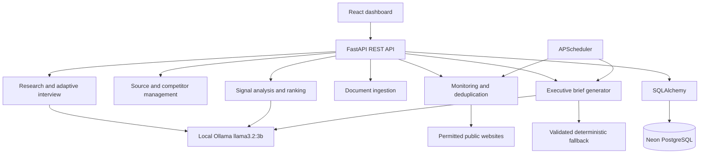
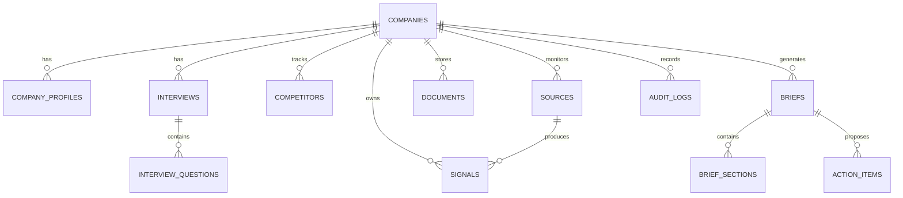

# Signal Stack — System Architecture & Implementation
**AI-Powered Company Intelligence & Executive Briefing Engine**  
EDXSO AI Engineer Assignment 1 | Implementation snapshot: 25 November 2026

## 1. Project overview
Signal Stack is a company-specific executive intelligence application that collects public source evidence and uploaded internal documents, analyzes signals using a local language model, and generates structured executive briefs. It separates source evidence from assumptions and AI interpretations. It is a local demonstration application, not a production-certified intelligence platform.

The workflow comprises company registration, initial research, adaptive interviews, competitor mapping, source management, monitoring, signal analysis, brief generation and scheduled maintenance. Four intelligence categories are supported: Customers, Competitors, Market and Internal.

## 2. Technology stack
| Layer | Implementation |
|---|---|
| Frontend | React 19, Vite, Tailwind CSS, Lucide React |
| Backend | Python 3.11, FastAPI, Pydantic v2 |
| Persistence | Neon PostgreSQL, SQLAlchemy 2, Alembic |
| AI | Local Ollama, llama3.2:3b |
| Monitoring | HTTP fetching, HTML text extraction, robots.txt checks, content hashing |
| Documents | PDF, CSV and TXT extraction; PostgreSQL text storage |
| Scheduling | APScheduler |
| Testing | pytest, frontend build and manual browser/API checks |

No paid inference API is required. Neon free-tier limits, local hardware, electricity and internet availability constrain operation. Local inference does not mean all data remains on-device: PostgreSQL is hosted on Neon.

## 3. System architecture

The dashboard uses a central API client. Vite proxies API and health requests to the backend; the demonstrated configuration uses frontend port 5173 and backend port 8001. The backend owns persistence, validation and business logic. Scheduler jobs run within the FastAPI process.

## 4. Project structure
Representative implemented paths (not an exhaustive filesystem listing):
```text
signal-stack/
  PROJECT_ARCHITECTURE.md
  README.md
  backend/
    app/
      main.py
      config.py
      database.py
      models/
      schemas/
      api/v1/
      services/
        ai/
          llm_client.py
          researcher.py
          interviewer.py
          signal_analyzer.py
          brief_generator.py
        crawler/scraper.py
        monitoring/pipeline.py
        scheduler/
          scheduler.py
          jobs.py
    requirements.txt
    tests/
  frontend/
    package.json
    vite.config.js
    src/
      App.jsx
      api/client.js
      components/
        Overview.jsx
        CompanySetup.jsx
        AdaptiveInterview.jsx
        CompetitorIntelligence.jsx
        SourceManager.jsx
        IntelligenceFeed.jsx
        ExecutiveBrief.jsx
        SchedulerHealth.jsx
  reports/
  docs/
  .gitignore
```
Local `.env` and `.venv` are development resources, not submission artifacts. Never commit credentials, private documents or dependency directories.

## 5. Database design
The initial relational schema contains 12 tables, using UUID identifiers and PostgreSQL JSONB where flexible metadata is required.
| Table | Responsibility |
|---|---|
| companies | Company identity, normalized website, lifecycle |
| company_profiles | Research results, verified source facts and assumptions |
| interviews | Company-specific interview sessions |
| interview_questions | Questions, answers, skips, edits and follow-ups |
| competitors | Competitor identity, relationship type and metadata |
| sources | Source category, URL, inclusion rationale and crawl health |
| documents | Uploaded document metadata and extracted content |
| signals | Evidence, content hash, classification, analysis and ranking |
| briefs | Dated executive report and generation status |
| brief_sections | Ten ordered report sections and referenced signal IDs |
| action_items | Evidence-linked proposed actions and priorities |
| audit_logs | Task outcomes and errors |


This diagram describes logical relationships; SQLAlchemy models and Alembic migrations are authoritative for physical columns and constraints. Competitor verification and descriptive metadata are serialized in the notes field in the reviewed implementation. Internal document signals retain document evidence references. Company-scoped queries prevent accidental mixing of company records, but are not a substitute for user authentication or tenant authorization.

## 6. REST API
Base path: `/api/v1`. In the table, `C` means `/api/v1/companies/{company_id}`. Consult `/docs` on the running backend for authoritative payloads and the newly added document upload route.

| Method | Path | Purpose |
|---|---|---|
| GET | /health | Backend and database health |
| POST, GET | /api/v1/companies | Register and list companies |
| GET, PATCH | C | Read and update company |
| POST, GET | C/research | Run and retrieve company research |
| GET | C/interview | Current interview |
| POST | C/interview/start | Start adaptive interview |
| GET | C/interview/{interview_id} | Retrieve interview |
| POST | C/interview/{interview_id}/answer | Submit answer or skip |
| PATCH | C/interview/{interview_id}/questions/{question_id} | Edit answer |
| GET | C/interviews | Interview history |
| GET, POST | C/sources | List and register sources |
| GET, PATCH, DELETE | C/sources/{source_id} | Read, edit, deactivate source |
| POST | C/sources/{source_id}/crawl | Crawl one source |
| GET, POST | C/competitors | List and register competitors |
| PATCH | C/competitors/{competitor_id} | Update competitor |
| POST | C/competitors/{competitor_id}/deactivate | Deactivate competitor |
| POST | C/competitors/discover | AI-assisted competitor suggestions |
| POST | C/monitoring/run | Run company monitoring |
| GET | C/signals | Paginated intelligence records |
| GET | C/signals/ranked | Ranked intelligence |
| POST | C/signals/{signal_id}/analyze | Analyze a signal |
| POST | C/briefs/generate | Generate and persist brief |
| GET | C/briefs/current | Current brief |
| GET | C/briefs | Brief history |
| GET | C/briefs/{brief_id} | Retrieve saved brief |
| GET | /api/v1/scheduler/status | Scheduler state |
| POST | /api/v1/scheduler/jobs/weekly-briefs/run | Manual weekly job |
| POST | /api/v1/scheduler/jobs/monthly-source-health-audit/run | Manual monthly audit |

Source registration accepts `name`, `url`, `category`, and optional `description`. Categories are `Customers`, `Competitors`, `Market`, `Internal`. The monitoring response includes `new_signals`. Document ingestion uses multipart upload via the Source Manager; exact route and request fields should be checked against current OpenAPI because the final upload code was not supplied for this documentation review. Markdown and PDF exports are frontend features, not separate backend export endpoints.

## 7. AI and ranking pipeline
Research extracts website-supported statements and separates assumptions. Adaptive interviewing uses company context and previous answers to generate sequential questions, supports skips and edits, and attempts to avoid repetition. Competitor discovery generates suggestions requiring verification; it is not a general web search engine.

Signal analysis uses stored evidence and company context to identify a development, its supported publication date if available, business area, opportunity/threat/neutral classification and strategic interpretation. Evidence excerpts are validated against stored text. Typographic normalization handles common punctuation differences. Unsupported dates and recommendations are omitted; individual signal recommendations are currently not populated by the analyzer.

The reviewed composite ranking formula is:

```
Rank = 0.25 * Impact + 0.20 * Urgency + 0.20 * Credibility
     + 0.10 * Relevance + 0.15 * Recency + 0.10 * Novelty
```
Scores are on a 0–10 scale and the composite is rounded to two decimals. Recency uses age decay; novelty uses token dissimilarity against recent company signals. The scores are heuristic prioritization aids, not calibrated probabilities.

## 8. Monitoring and internal intelligence
Sources are registered and managed per company. The crawler checks robots.txt, uses request delays and validates redirects and destination IPs to reduce SSRF risk. Failed or blocked requests are recorded rather than bypassed. Normalized content hashes suppress exact duplicate records within a company. HTML page extraction may capture multiple headlines as one signal; it is not guaranteed to isolate each event. Novelty scoring is distinct from duplicate detection.

Internal uploads support PDF, CSV and TXT, with a reported 10 MB limit, validation and duplicate prevention. Extracted content is persisted in PostgreSQL and used to create a company-specific evidence-linked signal. A synthetic TXT upload was verified live. PDF/CSV live checks and internal-document inclusion in briefs remain pending. Scanned PDF OCR and Excel ingestion are not supported. Public company announcements are public evidence, even where the demo categorizes them as Internal; they are not confidential internal records.

## 9. Executive brief generation
Briefs use eligible verified, analyzed signals discovered in the preceding seven-day window. Evidence excerpts and signal references are checked before synthesis is persisted. Invalid LLM synthesis is discarded; a deterministic fallback produces the ten sections using validated stored evidence without inventing actions, assumptions or watch items. This fallback was exercised live for IKEA. Verification means traceability to stored source text, not independent confirmation of every source claim.

Required sections:
1. Executive Summary
2. Customer Signals
3. Competitor Intelligence
4. Market Intelligence
5. Internal Business Intelligence
6. Opportunities
7. Risks & Threats
8. Recommended Actions for This Week
9. What We Should Watch
10. Source Appendix

Sections with insufficient evidence explicitly say so. Saved briefs support history, an action-item display, Markdown export and browser Print/PDF export. Recommendations are AI proposals rather than verified facts.

## 10. Automated scheduling
APScheduler starts and stops with FastAPI. `SCHEDULER_TIMEZONE` defaults to `Asia/Kolkata`.
| Job | Schedule | Behavior |
|---|---|---|
| Weekly briefs | Monday 08:00 | Generate from stored eligible signals; skip existing weekly brief |
| Monthly source audit | Day 1, 09:00 | Reuse monitoring pipeline, update source health and record outcomes |

Stable job IDs, coalescing and one in-process instance reduce overlapping execution. Weekly generation uses a company-row lock and week lookup. Run one scheduler-owning backend process. Jobs do not run while the local application is stopped. Monthly monitoring can also create new signals. Continuous unattended monitoring and actual scheduled delivery have not been demonstrated; manual generation and active scheduler status have been demonstrated.

## 11. Dashboard
The SPA provides Overview, Companies & Intel, Competitor Intel, Adaptive Interview, Ethical Sources, Signal Radar, Executive Briefs and Scheduler & Health. A shared company selector scopes data views. The interface supports research, source management, document upload, signal filtering and analysis, saved report history and export. Backend health and scheduler state are visible.

## 12. Security and operational limitations
- Keep database credentials in local environment configuration; use isolated databases for tests. Rotate any previously exposed credentials before submission.
- Use only permitted public sources and authorized internal documents. Robots.txt checks alone do not establish permission under website terms.
- URL and IP validation, redirect checks and request throttling reduce crawler risk; DNS rebinding remains a documented limitation.
- Local Ollama avoids sending inference prompts to a paid external LLM service, but hosted PostgreSQL stores extracted content.
- Do not expose this local demonstration publicly without authentication, authorization, deployment hardening and a security review.
- Synthetic test documents must remain clearly labeled and excluded from genuine business reports. A source-evidence badge does not establish truth of synthetic claims.
- Dedicated RSS item parsing, DuckDuckGo source discovery, SQLite fallback, Excel parsing and backend export endpoints are not implemented.

## 13. Demonstration and testing evidence
Snapshot from the reported API responses and browser checks:
| Company | Registered sources | Web signals | Analyzed signals | Saved briefs | Sections | Actions |
|---|---:|---:|---:|---:|---:|---:|
| MeetUniversity | 24 | 25 | 13 | 1 | 10 | 0 |
| Stripe | 5 | 5 | 1 | 1 | 10 | 5 |
| IKEA | 5 | 5 | 1 | 1 | 10 | 0 |
| Total | 34 | 35 | 15 | 3 | 30 | 5 |

MeetUniversity additionally has five active competitor profiles marked verified with evidence URLs: IDP Education, ApplyBoard, Yocket, GradRight and AdmitKard. One synthetic TXT upload increased its total signals to 26 and the overall total to 36; it is not counted as genuine web intelligence. The 35 web records are stored records, not necessarily 35 independently verified distinct business developments. Source count does not prove approval, relevance or terms compliance for every URL.

All three saved reports were confirmed ready with ten sections and exported in PDF and Markdown. Each exported report relies on one unique signal; MeetUniversity's report predates later analysis, Stripe contains five proposed actions, and IKEA demonstrates fallback with no actions. Coverage is incomplete across intelligence categories.

Reported automated test results from development (overlapping runs; do not add counts):
| Test run | Result |
|---|---|
| Earlier backend suite | 286 passed, 8 setup errors, 13 warnings |
| Scraper focused tests | 63 passed |
| Research focused tests | 58 passed |
| Adaptive interview focused tests | 46 passed |
| Competitor focused tests | 38 passed |
| Scheduler focused tests | 25 passed |
| Latest brief fallback focused tests | 12 passed, 2 warnings |
| Document ingestion focused tests | 5 passed |
| Frontend build after ingestion | Passed; seven lint warnings reported |

The earlier eight setup errors were attributed to missing TEST_DATABASE_URL. A complete final regression run has not been performed. Live checks confirmed backend/database health, company switching, signal creation, analysis, three brief generations, fallback, exports and TXT ingestion. Full adaptive interview walkthrough, PDF/CSV ingestion, scheduled execution and final regression remain to be verified.

## 14. Final delivery status
Core application and three-company demonstration are operational. Reports are exported. Remaining submission tasks include README/setup instructions, concise technical documentation, cost statement, testing evidence, credential-safe GitHub publication and demonstration recording. Prioritize accurate disclosure of limitations over unsupported claims of complete production readiness.
