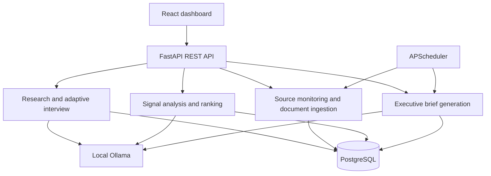

# Signal Stack

**AI-Powered Company Intelligence & Executive Briefing Engine**  
EDXSO AI Engineer Internship — Assignment 1

## Overview

Signal Stack is a full-stack executive intelligence application that researches companies, collects evidence from public sources and internal documents, analyzes business developments, and generates weekly executive briefs. It uses a local LLM rather than paid AI APIs.

## Features

- Company registration, duplicate protection, company switching and AI-assisted research with facts separated from assumptions.
- Adaptive interviews with sequential questions, follow-ups, confidential skips and editable answers.
- Competitor management and AI-assisted competitor suggestions requiring verification.
- Four intelligence categories: Customers, Competitors, Market and Internal.
- Source management, robots.txt checks, crawl throttling, content hashing, evidence preservation and crawl health reporting.
- PDF, CSV and TXT document ingestion with company-specific evidence-linked signals.
- AI-assisted signal classification, impact and urgency assessment, and ranking.
- Ten-section executive briefs, historical reports, action items and Markdown/Print-to-PDF exports.
- Weekly brief scheduling and monthly source health audits.

## Technology stack

| Layer | Technology |
|---|---|
| Frontend | React 19, Vite 8, Tailwind CSS 4, Lucide React |
| Backend | Python, FastAPI, Uvicorn, Pydantic |
| Database | Neon PostgreSQL, SQLAlchemy 2, psycopg 3, Alembic |
| Local AI | Ollama, llama3.2:3b |
| Crawling | HTTPX, Requests, BeautifulSoup4, lxml |
| Documents | pypdf, CSV and text processing, python-multipart |
| Scheduling | APScheduler 3.x, tzdata |
| Testing | pytest, Oxlint, Vite production build |

## Architecture



See [PROJECT_ARCHITECTURE.md](PROJECT_ARCHITECTURE.md) for implementation details.

## Getting started (Windows PowerShell)

### Prerequisites

Python 3.11, Node.js 24, npm, Git, Ollama, and a PostgreSQL database. The development environment used Python 3.11.9 and Node.js 24.14.1. Use a dedicated development database or Neon branch, not a production database.

Open a terminal in the cloned repository root.

### 1. Backend dependencies

```powershell
python -m venv .venv
.\.venv\Scripts\Activate.ps1
python -m pip install -r backend/requirements.txt
```

### 2. Environment configuration

```powershell
Copy-Item .env.example .env
```

Edit the root `.env` and replace the placeholder `DATABASE_URL` with your own development PostgreSQL connection string. Never commit `.env`. Environment variables set in the shell can override values in this file.

| Variable | Purpose / default |
|---|---|
| DATABASE_URL | Required PostgreSQL connection string |
| OLLAMA_BASE_URL | http://localhost:11434 |
| OLLAMA_MODEL | llama3.2:3b |
| SCHEDULER_TIMEZONE | Asia/Kolkata |
| TEST_DATABASE_URL | Separate disposable test database for database integration tests |

### 3. Local AI model

Install Ollama from https://ollama.com/ and run:

```powershell
ollama pull llama3.2:3b
ollama list
```

If Ollama is not already running, start `ollama serve` in a separate terminal. Local inference speed depends on available hardware.

### 4. Database initialization and backend

From the repository root with the virtual environment active:

```powershell
cd backend
python -c "from app.config import settings; from urllib.parse import urlparse; print(urlparse(settings.sync_database_url).hostname)"
```

Confirm the printed host belongs to your intended development database before applying migrations. Do not proceed against a production or shared database.

```powershell
python -m alembic upgrade head
python -m uvicorn app.main:app --host 127.0.0.1 --port 8001
```

- API documentation: http://127.0.0.1:8001/docs
- Health endpoint: http://127.0.0.1:8001/health

### 5. Frontend

Open another terminal at the repository root:

```powershell
cd frontend
npm install
npm run dev
```

Open http://localhost:5173. The demonstrated Vite configuration proxies `/api` and `/health` to port 8001; ensure the proxy matches the backend port.

## Application workflow

1. Register a company in Companies & Intel and run research.
2. Complete the Adaptive Interview with relevant, non-confidential business context.
3. Review competitor suggestions and verify evidence before treating them as confirmed.
4. Register relevant permitted sources under Ethical Sources; optionally upload authorized internal documents.
5. Run monitoring from Signal Radar and analyze collected signals.
6. Generate a brief from Executive Briefs and inspect its evidence and limitations.
7. Export Markdown or use the browser print dialog to save a PDF.
8. Switch companies to view company-specific records and inspect Scheduler & Health.

## Signal ranking

The implemented composite score uses a 0–10 scale:

`0.25 × Impact + 0.20 × Urgency + 0.20 × Credibility + 0.10 × Relevance + 0.15 × Recency + 0.10 × Novelty`

Recency uses age-based decay; novelty uses token similarity against recent company signals. AI interpretations are distinct from stored evidence. Evidence matching does not independently prove the truth of a source's claims.

## Executive brief

Each report contains ten sections:

1. Executive Summary
2. Customer Signals
3. Competitor Intelligence
4. Market Intelligence
5. Internal Business Intelligence
6. Opportunities
7. Risks & Threats
8. Recommended Actions for This Week
9. What We Should Watch
10. Source Appendix

The generator uses eligible verified, analyzed signals from the recent discovery window. Invalid AI evidence references are rejected; deterministic fallback can produce an evidence-backed report without unsupported recommendations. Sections with insufficient evidence remain explicitly limited.

## Demonstration results

Snapshot from 25 November 2026:

| Company | Industry | Sources registered | Signal records | Exported brief |
|---|---|---:|---:|---|
| MeetUniversity | Education / study abroad | 24 | 26 | PDF + Markdown |
| Stripe | Financial technology | 5 | 5 | PDF + Markdown |
| IKEA | Furniture / retail | 5 | 5 | PDF + Markdown |

There were 35 web-derived signal records and one clearly labeled synthetic TXT document signal. These counts do not imply 35 distinct, independently verified developments. Five MeetUniversity competitor profiles were recorded with evidence URLs and verification flags. Each exported brief contains all ten sections but relies on only one unique signal. See the `reports/` directory for the six exported files.

## Automation

| Job | Default schedule (Asia/Kolkata) |
|---|---|
| Weekly executive briefs | Monday, 08:00 |
| Monthly source health audit | First day of each month, 09:00 |

The scheduler runs within the FastAPI process. Keep one scheduler-owning worker running for local demonstrations. Scheduled weekly generation uses duplicate-week protection; monthly audits reuse the monitoring pipeline. Scheduler status and manual triggers are exposed through the API. Actual unattended scheduled execution has not yet been verified in the demo environment.

## Selected API endpoints

Company-specific paths below use `/api/v1/companies/{company_id}` as their prefix.

| Method | Path | Purpose |
|---|---|---|
| GET / POST | /api/v1/companies | List / register companies |
| GET / POST | /research | Read / run company research |
| POST | /interview/start | Start interview |
| POST | /interview/{interview_id}/answer | Submit answer |
| GET / POST | /sources | List / add sources |
| POST | /competitors/discover | Suggest competitors |
| POST | /monitoring/run | Monitor active sources |
| GET | /signals | List signals |
| GET | /signals/ranked | Ranked intelligence |
| POST | /signals/{signal_id}/analyze | Analyze signal |
| POST | /briefs/generate | Generate brief |
| GET | /briefs/current | Current brief |
| GET | /briefs | Brief history |
| GET | /api/v1/scheduler/status | Scheduler status |

Use the live Swagger documentation for exact request schemas and the full route inventory.

## Testing

Install pytest in the development virtual environment if it is not already installed. Use a separate disposable test database for integration tests; never point `TEST_DATABASE_URL` at production or the populated demonstration database.

```powershell
cd backend
python -m pip install pytest
python -m pytest tests -v
```

Frontend checks (from the frontend directory):

```powershell
npm run lint
npm run build
```

Previously reported backend suite: 286 passed, 8 setup errors due to missing TEST_DATABASE_URL, 13 warnings, no assertion failures. Later focused brief and document-ingestion tests reported 12 and 5 passes respectively. These are historical runs, not a fresh full-suite certification. The frontend build passed; seven lint warnings remained. Live monitoring, signal analysis, three brief exports and synthetic TXT ingestion were demonstrated. Final live adaptive interview verification remains outstanding.

## Security, ethics and limitations

- Use only permitted public sources and authorized documents. Robots.txt checks do not replace reviewing site terms. Blocked sources are not bypassed.
- The scraper includes private-address and redirect checks, but DNS rebinding remains a documented limitation.
- Internal extracted text is stored in PostgreSQL, which may be hosted remotely. Local AI inference does not mean all data stays on the local machine.
- HTML monitoring may capture multiple headlines or homepage text; dedicated RSS parsing and automated public source discovery are not implemented.
- PDF and CSV ingestion have not been live-verified; scanned PDF OCR and Excel ingestion are not supported in the demonstrated implementation.
- Public official company content was sometimes categorized as Internal; source categorization and report relevance need further review.
- Signal-level recommended actions may be absent. Brief recommendations can be sparse or need executive-perspective review.
- No production deployment, complete security audit, or full post-change regression run is claimed.
- No paid AI API usage was reported. Hosting limits, electricity and future infrastructure costs are not guaranteed to be zero.

## Repository layout

```text
signal-stack/
  backend/                 FastAPI, models, services, migrations, tests
  frontend/                React dashboard and API client
  reports/                 Three briefs in PDF and Markdown
  docs/                    Technical documentation and submission evidence
  PROJECT_ARCHITECTURE.md  Implementation architecture
  README.md                Setup and project overview
  .env.example             Safe configuration template
  .gitignore               Local file exclusions
```

Keep credentials, private documents, virtual environments, node_modules and generated caches out of version control. Review all staged files before publishing.


## 🎥 Project Demonstration

[Watch the Full Project Demo](https://drive.google.com/file/d/1vsJj6D-dPElr63f75QsWhIhu9HotE16M/view?usp=sharing)

The demonstration covers:
- AI-powered company research
- Adaptive interview system
- Competitor intelligence
- Ethical web monitoring
- Signal analysis and ranking
- Executive brief generation
- Multi-company management
- Automated scheduling